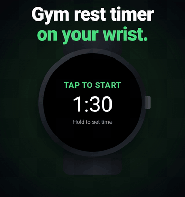
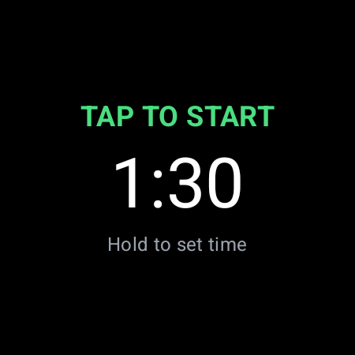
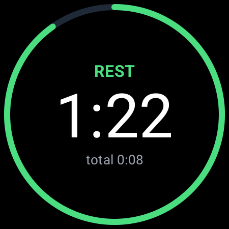
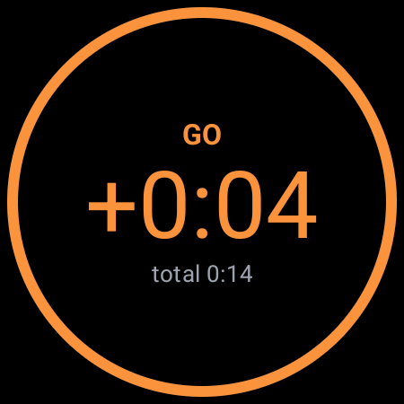
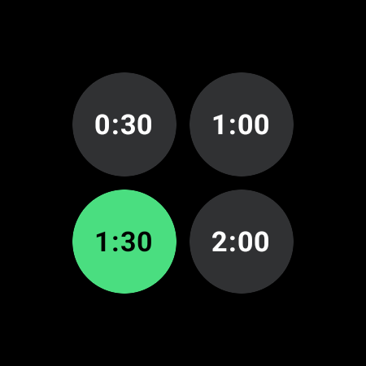
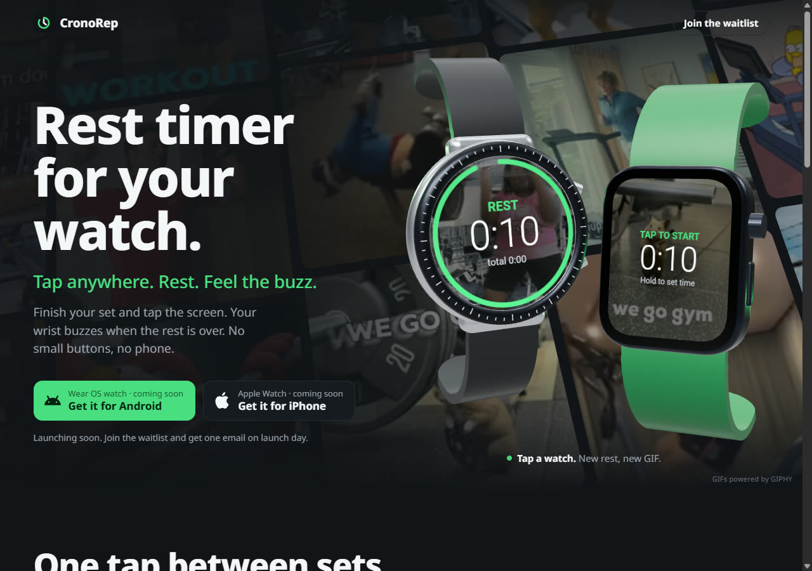
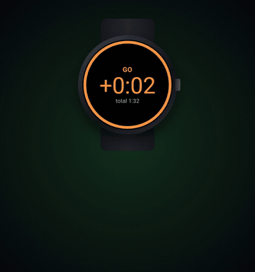

# CronoRep

🌐 [English](README.md) · **Español**

**El temporizador de descanso del gimnasio para tu reloj y tu teléfono.**
Toca donde quieras. Descansa. Siente la vibración.

[**🌐 Web**](https://enautomatico.online/cronorep/?lang=es) ·
[**⌚ Únete a la lista de espera**](https://enautomatico.online/cronorep/?lang=es) ·
[**🔒 Privacidad**](https://enautomatico.online/cronorep/privacy)

## Por qué

Entre series quieres una sola cosa: saber cuándo volver a levantar.
La mayoría de los temporizadores tienen botones pequeños, menús y te piden atención.
CronoRep solo necesita **un toque en cualquier parte de la pantalla**. Tu reloj o tu teléfono te avisa cuándo levantar.

## Qué hace

| | |
| --- | --- |
| 👆 **Toca donde quieras** | Empieza o reinicia el descanso. Sin botones pequeños. |
| ⏱️ **3 toques suaves** | Un aviso en los últimos 3 segundos. |
| 📳 **Una vibración larga** | El descanso terminó, también con la muñeca abajo. |
| ➕ **Cuenta hacia arriba** | Ves cuánto tiempo te pasas. |
| ✋ **Mantén pulsado para el tiempo** | Cambia el descanso en pasos de 5 segundos. |
| 🔢 **Tiempos fijos** | Desliza para 0:30, 1:00, 1:30 y 2:00. |
| 🎞️ **GIFs de gimnasio** | Un GIF divertido opcional detrás del temporizador. Uno nuevo en cada descanso. |
| 🎨 **A tu gusto** | Modo minimalista, modo ahorro de batería y fondos: negro, degradados de color o GIFs de gimnasio. |
| 📱 **App de teléfono** | ¿Sin reloj? La app de teléfono tiene el mismo temporizador. También elige el aspecto del reloj. |
| 🚫 **Sin anuncios, sin cuenta** | La app del reloj funciona sola. La app del teléfono funciona sola. |

> Las apps por ahora están en inglés.

## Fondos con GIFs de gimnasio

Elige el fondo **GIF** en los ajustes y cada descanso tiene un GIF de gimnasio nuevo.

 GIFs powered by GIPHY

## Consigue la app

- **Wear OS:** muy pronto en Google Play
- **Teléfono Android:** muy pronto en Google Play (la misma ficha que Wear OS)
- **Apple Watch:** muy pronto en el App Store
- **Email el día del lanzamiento:** [únete a la lista de espera](https://enautomatico.online/cronorep/?lang=es)

10 horas gratis. Luego un solo pago de 1,99 $ desbloquea la app del reloj y la del teléfono para siempre. Sin suscripción.

## Estructura del proyecto

| Ruta | Qué es |
| --- | --- |
| `app/` | App de Wear OS (Kotlin, Jetpack Compose para Wear OS) |
| `mobile/` | App de teléfono Android: el mismo temporizador y los ajustes de aspecto del reloj |
| `shared/` | Código que comparten la app del reloj y la del teléfono |
| `apple/` | App de Apple Watch (SwiftUI). `project.yml` es una especificación de [XcodeGen](https://github.com/yonaskolb/XcodeGen) |
| `web/` | La web con el reloj 3D |
| `waitlist-api/` | API de la lista de espera (Neon Function) |
| `codemagic.yaml` | Compilación en la nube de la app de Apple Watch (sin Mac) |
| `docs/store/` | Textos de las tiendas, política de privacidad y capturas |

## Compílala tú

**Android (reloj y teléfono)**

1. Instala Android Studio y abre esta carpeta.
2. Ejecuta la configuración `app` en un emulador o reloj Wear OS, o la configuración `mobile` en un teléfono.

Las compilaciones debug nunca se bloquean, así que puedes probarlo todo. Una compilación release necesita tu propia
clave de subida en `keystore/` y `keystore.properties` (git ignora los dos).

**Apple Watch**

1. En un Mac: `brew install xcodegen`, luego `cd apple && xcodegen`.
2. Abre el proyecto de Xcode generado y ejecuta el target del reloj.

Sin Mac, mira `codemagic.yaml`.

## Privacidad

Sin cuenta, sin analíticas, sin anuncios. Los ajustes se quedan en tus dispositivos.
[Política de privacidad](https://enautomatico.online/cronorep/privacy)

## Licencia

MIT. Mira [LICENSE](LICENSE). El nombre "CronoRep" y el icono de la app no son parte de la licencia:
si publicas tu propia versión, usa tu propio nombre e icono.

 
⭐ <b>Dale una estrella al repo</b> si te ayuda a descansar.

