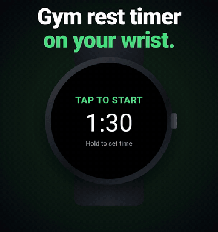

# CronoRep

**The gym rest timer for your watch and phone.**
Tap anywhere. Rest. Feel the buzz.

[**🌐 Website**](https://enautomatico.online/cronorep/) ·
[**⌚ Join the waitlist**](https://enautomatico.online/cronorep/) ·
[**🔒 Privacy**](https://enautomatico.online/cronorep/privacy)

## Why

Between sets you want one thing: know when to go again.
Phone timers need unlocking, small buttons and your attention.
CronoRep needs **one tap anywhere on the watch**. Your wrist tells you when to lift.

## What it does

| | |
| --- | --- |
| 👆 **Tap anywhere** | Start or restart the rest. No small buttons. |
| ⏱️ **3 soft ticks** | A warning in the last 3 seconds. |
| 📳 **One long buzz** | Rest is over, also with your wrist down. |
| ➕ **Counts up after** | See how long you go over. |
| ✋ **Hold to set time** | Change the rest in 5 second steps. |
| 🔢 **Presets** | Swipe for 0:30, 1:00, 1:30 and 2:00. |
| 🎞️ **Gym GIFs** | Optional funny GIF behind the timer. A new one each rest. |
| 🎨 **Make it yours** | Minimalist mode, save battery mode, and backgrounds: black, colour gradients or gym GIFs. |
| 📱 **Phone app** | No watch? The phone app has the same timer. It also sets the look for the watch. |
| 🚫 **No ads, no account** | The watch app works alone. The phone app works alone. |

## Gym GIF backgrounds

Choose the **GIF** background in the settings and every rest gets a new gym GIF.

 GIFs powered by GIPHY

## Get the app

- **Wear OS:** coming soon to Google Play
- **Android phone:** coming soon to Google Play (the same listing as Wear OS)
- **Apple Watch:** coming soon to the App Store
- **Launch day email:** [join the waitlist](https://enautomatico.online/cronorep/)

10 hours free. Then one payment of $1.99 unlocks the watch app and the phone app forever. No subscription.

## Project layout

| Path | What it is |
| --- | --- |
| `app/` | Wear OS app (Kotlin, Jetpack Compose for Wear OS) |
| `mobile/` | Android phone app: the same timer, and look settings for the watch |
| `shared/` | Code that the watch app and the phone app share |
| `apple/` | Apple Watch app (SwiftUI). `project.yml` is an [XcodeGen](https://github.com/yonaskolb/XcodeGen) spec |
| `web/` | The landing page with the 3D watch hero |
| `waitlist-api/` | Waitlist API (Neon Function) |
| `codemagic.yaml` | Cloud build for the Apple Watch app (no Mac needed) |
| `docs/store/` | Store listing text, privacy policy and screenshots |

## Build it yourself

**Android (watch and phone)**

1. Install Android Studio and open this folder.
2. Run the `app` configuration on a Wear OS emulator or watch, or the `mobile` configuration on a phone.

Debug builds never lock, so you can test everything. A release build needs your own
upload key in `keystore/` and `keystore.properties` (both are git-ignored).

**Apple Watch**

1. On a Mac: `brew install xcodegen`, then `cd apple && xcodegen`.
2. Open the generated Xcode project and run the Watch target.

Without a Mac, see `codemagic.yaml`.

## Privacy

No account, no analytics, no ads. Settings stay on your devices.
[Privacy policy](https://enautomatico.online/cronorep/privacy)

## License

MIT. See [LICENSE](LICENSE). The name "CronoRep" and the app icon are not part of the license:
if you publish your own build, use your own name and icon.

 
⭐ <b>Star the repo</b> if it helps your rest.

