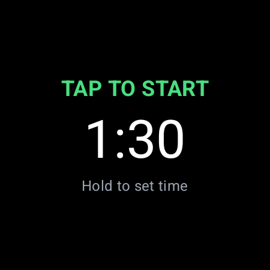
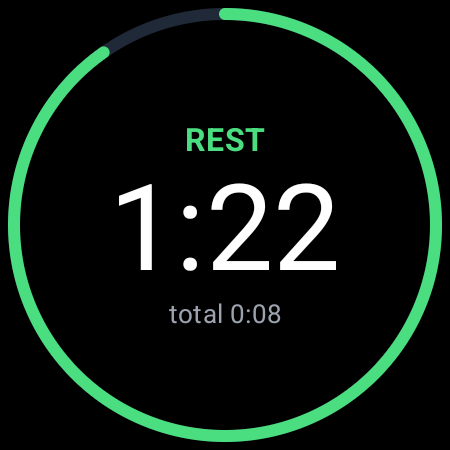
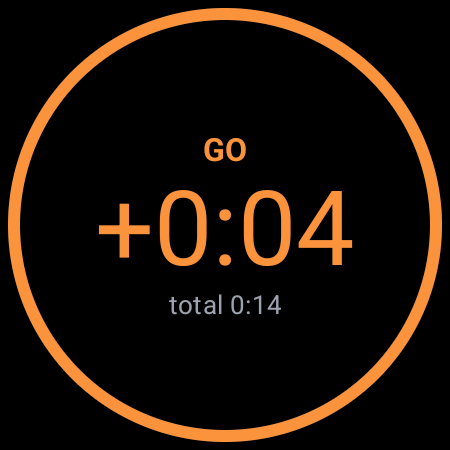

# CronoRep: gym rest timer for your watch and phone

Finish your set. Tap anywhere on the watch. Rest.
Your wrist buzzes when the rest is over. No small buttons, no menus.
No watch? The phone app has the same timer.

  
  
  

## Get the app

- **Wear OS:** [Google Play](https://play.google.com/store/apps/details?id=com.cronorep) (the link works when the listing is live)
- **Android phone:** [Google Play](https://play.google.com/store/apps/details?id=com.cronorep) (the same listing as Wear OS)
- **Apple Watch:** coming soon to the App Store

10 hours free. Then one payment of $1.99 unlocks it forever. No subscription, no ads, no account.

## What it does

- Tap anywhere to start or restart the rest timer.
- Three soft ticks in the last 3 seconds.
- One long vibration when the rest ends, also with your wrist down.
- After that it counts up, so you see how long you go over.
- Hold the screen to set the rest time in 5 second steps.
- Swipe for presets: 0:30, 1:00, 1:30, 2:00.
- Minimalist mode, save battery mode, and backgrounds: black, colour gradients or funny gym GIFs (GIPHY).
- The phone app sets the look for the watch too.

## Project layout

| Path | What it is |
| --- | --- |
| `app/` | Wear OS app (Kotlin, Jetpack Compose for Wear OS) |
| `mobile/` | Android phone app: the same timer, and look settings for the watch |
| `shared/` | Code that the watch app and the phone app share |
| `apple/` | Apple Watch app (SwiftUI). `project.yml` is an [XcodeGen](https://github.com/yonaskolb/XcodeGen) spec |
| `codemagic.yaml` | Cloud build for the Apple Watch app (no Mac needed) |
| `docs/store/` | Store listing text, privacy policy and screenshots |

## Build it yourself

**Android (watch and phone)**

1. Install Android Studio and open this folder.
2. Run the `app` configuration on a Wear OS emulator or watch, or the `mobile` configuration on a phone.

Debug builds never lock, so you can test everything. A release build needs your own
upload key in `keystore/` and `keystore.properties` (both are git-ignored).

**Apple Watch**

1. On a Mac: `brew install xcodegen`, then `cd apple && xcodegen`.
2. Open the generated Xcode project and run the Watch target.

Without a Mac, see `codemagic.yaml`.

## Privacy

No account, no analytics, no ads. Settings stay on your devices.
[Privacy policy](https://enautomatico.online/cronorep/privacy)

## License

MIT. See [LICENSE](LICENSE). The name "CronoRep" and the app icon are not part of the license:
if you publish your own build, use your own name and icon.
